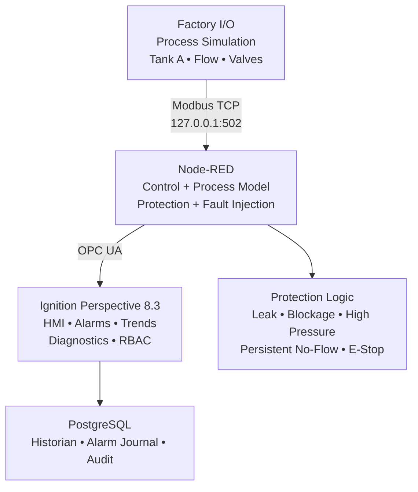

# PO-SCADA — Pipeline Operations SCADA System

**Integrated SCADA, process protection, diagnostics, security, audit, historian, and validation portfolio project.**

## Project at a glance

| Metric | Result |
|---|---:|
| Validated tests passed | **41** |
| Integrated FAT | **24/24 PASS** |
| Closed corrective actions | **3** |
| Security role levels | **3** |

PO-SCADA is a three-layer simulation and supervisory-control project integrating **Factory I/O**, **Node-RED**, and **Ignition Perspective 8.3**. It monitors tank level, flow, and pressure; implements startup/stop logic and protection against leak, no-flow, blockage, high pressure, low/high tank levels, and E-stop conditions; and adds historian, alarms, diagnostics, role-based security, and audit traceability.

## Architecture

### Layer 1 — Factory I/O
- Tank A level and inlet flow simulation
- Fill and discharge valve actuation
- Modbus TCP/IP server
- Final local endpoint: `127.0.0.1:502`, Slave ID `1`

### Layer 2 — Node-RED
- Command processing and sequence control
- Startup permissives and controlled shutdown
- Safety/interlock logic
- Leak, blockage, high-pressure and persistent no-flow detection
- Calculated / virtual process values
- Fault injection and commissioning support
- OPC UA supervisory interface to Ignition

### Layer 3 — Ignition Perspective
- Process Overview
- Alarms and Trends
- Diagnostics and Heartbeat
- Engineering Settings
- Reusable UDT-based instrument and valve faceplates
- Operator / Engineer / Administrator access control
- Audit logging and historian integration
- PIFDE explainable rule-based advisory layer

## Protection and control scope

- Start permissives and startup sequence
- Controlled operator stop
- Emergency stop and trip latching
- Tank A low-low protection
- Tank B high-high shutdown
- High-pressure protection
- Leak warning and leak-confirmed logic
- Blockage detection
- Persistent no-flow detection
- Trip reset permissives and safe recovery
- Simulated flow and pressure sensor faults

## Validation highlights

The backend software FAT recorded **17 executed tests PASS** plus one valve-health test **NOT EXECUTED** because the simulation has no real valve-position health feedback.

The integrated Ignition FAT recorded **24/24 PASS** across process, protection, alarms, trends, diagnostics, security, audit, cross-browser behavior, communication loss, and recovery.

A representative protection test injected a transfer fault at `17:55:53`; the persistent no-flow trip was recorded at `17:55:59` (~6 s), validating the configured persistence behavior.

Three commissioning findings were corrected, retested, and formally closed:

1. Tank B model accumulation was too aggressive.
2. Persistent no-flow logic initially used physical flow instead of effective modeled flow.
3. Reset permissive initially allowed reset while a simulated transfer fault remained active.

## Security model

| Role | Access |
|---|---|
| Operator | Operational views; protected engineering/diagnostic views denied |
| Engineer | Engineering and diagnostics |
| Administrator | Full access including security/audit |

Perspective view permissions were validated using positive and negative access tests, including **Access Denied** behavior for unauthorized users.

## Technology stack

**Ignition Perspective 8.3.x · Node-RED · Factory I/O · Modbus TCP · OPC UA · PostgreSQL · Tag Historian · Alarm Journal · Audit Profile · UDTs / Faceplates**

## Documentation

- [Executive Project Brief — GitHub Edition](docs/EXECUTIVE_PROJECT_BRIEF.md)
- [Integrated Validation Summary](docs/INTEGRATED_VALIDATION_SUMMARY.md)
- [Software FAT & Commissioning Report](docs/COMMISSIONING_REPORT.md)
- [Commissioning Test Matrix](docs/COMMISSIONING_TEST_MATRIX.csv)
- [Publication / Security Scope](SECURITY.md)

## Reusable engineering example

- [Analog Instrument UDT Instances](examples/PO_SCADA_AnalogInstrument_Instances_v1.json)

## Original portfolio assets

The original final PDFs and live SCADA screenshots are kept in the sanitized portfolio asset package prepared with this repository. They are intentionally not represented as text-only GitHub files. See [Asset Manifest](media/ASSET_MANIFEST.md).

## Engineering scope note

This is a **software/simulation commissioning project**. It is not a site SAT, SIL assessment, or certification of a real Safety Instrumented System. In a real installation, critical safety functions would remain in suitable PLC/SIS hardware and follow the applicable functional-safety lifecycle.

## Author

**Ibrahim Ali Ghanim**  
Industrial Automation · SCADA · OT / IIoT · System Integration
